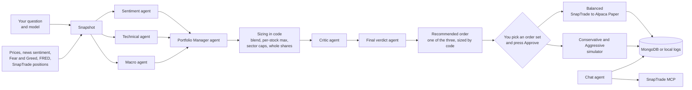

# Snapi - Turn your brokerage into your own AI hedge fund

Snapi uses the **SnapTrade API**, the **SnapTrade MCP** server and an **Alpaca Paper** account to run your very own AI hedge fund on simulated money at real market prices. One investment view is sized for three investor profiles, **Conservative**, **Balanced** and **Aggressive**, each with its own **sector caps**, **position limits** and **cash buffer**. The Balanced book trades through SnapTrade into Alpaca Paper, while the other two run on a built-in simulator. Every cycle enforces the caps with **pro-rata trims** and **ETF rebalancing** into underweight sectors, tracks performance against **SPY**, and waits for you to press **Approve** before a single order goes out.

Behind the scenes, a **swarm of seven Claude agents** does the thinking. Three analysts run concurrently: **Sentiment** reads per-stock news sentiment from **Alpha Vantage** and the market's **Fear and Greed** mood, **Technical** scores **RSI**, **MACD** and **50/200-day moving-average crosses**, and **Macro** checks five recession signals from **FRED** (yield curve, Sahm rule, credit spreads, VIX, and the S&P 500 against its 200-day average) to call the market risk-on, neutral or risk-off. A **Portfolio Manager** blends their views, a **devil's-advocate Critic** argues against the exact orders, and a **Final verdict** agent weighs every output and picks the portfolio to follow, whose orders become the **recommended order**. A **chat agent** answers plain-English questions about your holdings through **SnapTrade's official MCP server**. You can ask the swarm your own question and switch between **Haiku**, **Sonnet** and **Opus** for any run or chat. The agents form the views, but plain code does every calculation, so the AI never sizes a trade.

## Tech stack

| Category | What we use | Role |
|---|---|---|
| AI agents | **LangGraph** StateGraph, **Claude** via `langchain-anthropic` | Three analysts fan out concurrently, then fan in to the PM, the sizing step, the Critic and the Final verdict, which picks the recommended order. Each agent makes one structured-output call |
| Models | **Claude Haiku 4.5**, **Claude Sonnet 5** and **Claude Opus 5.5** | Switch the model for each swarm run and each chat question from the Committee and Chat pages. `SNAPI_MODEL` sets the default |
| Brokerage | **SnapTrade Python SDK v13**, **Alpaca Paper**, **SnapTrade Sandbox** | Real paper orders, live positions and balances, plus dividends, splits and order history |
| Chat | **SnapTrade hosted MCP** (read-only) | Portfolio Q&A that can never place a trade. Recent chats are saved to MongoDB, so you can reopen and continue them |
| Market data | **yfinance**, **Alpha Vantage**, **CNN Fear and Greed**, **FRED / ALFRED**, **stockstats** | Prices, fundamentals, news sentiment, market mood, macro series and indicators |
| App and storage | **Streamlit**, **Plotly**, **MongoDB Atlas** | A password-protected dashboard. Progress and recent chats are saved to MongoDB when `MONGODB_URI` is set, and to local files otherwise. Swarm results are not saved between sessions: Previous runs lasts only for your session, because market data changes from run to run |
| Hosting | **Streamlit Community Cloud** | The same live app as localhost, with the same settings |
| Tooling | **Python 3.12**, **uv**, **ruff**, **pytest**, **GitHub Actions** | Package management, lint and tests on every push |
| Finance | Conviction blend, macro regime, sector caps, backtest | **0.6 x Technical + 0.4 x Sentiment** conviction. The macro regime sets how much is invested (100%, 75% or 50% of each persona's ceiling). A Fear and Greed contrarian tilt, and a per-stock tilt against a forward P/E stretched for its sector or heavy debt. Sector caps with pro-rata trims and ETF refills. A **1-year weekly backtest against SPY** with 5 bps costs and point-in-time macro data. A **forward test** tracking NAV against SPY. The Critic flags any position down more than 10% |

## Architecture



**How a cycle works**
1. Type a question or keep the default one, pick Haiku, Sonnet or Opus, and press **Run swarm**. It takes one snapshot of prices, news, market mood, macro data and your books.
2. The three analysts read it at the same time, and each card on screen fills in as its agent finishes.
3. The Portfolio Manager can drop a name with a reason but never add or upsize one.
4. Code then blends the scores, applies each persona's limits and sector caps, and turns the result into whole-share orders.
5. The Critic reviews those exact orders, then the Final verdict weighs every agent's output and picks the persona to follow. Its orders become the recommended order.
6. You choose the recommended order or any of the three order sets and press **Approve**.
7. **Rebalance** runs the same sector-cap logic on demand, with no AI calls, and shows before-and-after sector weights.

## What you can ask it

- What is the news flow saying about the stocks I hold?
- Is the trend on my side for NVDA right now?
- Does the economy look fragile enough that I should hold more cash?
- Am I too concentrated in one sector, and what would I trade to fix it?
- How would a cautious investor and an aggressive investor act on the same view?
- What is the strongest argument against the trades I am about to make?
- Which of the three portfolios should I follow today?
- What would change if I moved to a stricter mandate?
- How is my paper portfolio doing against SPY since I started?
- How would these rules have done over the past year?
- What is my largest sector exposure? (on the Chat page)

## Run it on your machine

You need [uv](https://docs.astral.sh/uv/), which installs Python 3.12 for you, and a set of free accounts and keys:
- Anthropic API key
- SnapTrade Personal key, with Alpaca Paper connected for trading and the Sandbox connected for reading
- Alpha Vantage key
- FRED key
- Optional: Alpaca paper keys for the news fallback
- Optional: a MongoDB Atlas free cluster

1. Clone the repo and install the dependencies:
   ```bash
   git clone <your-repo-url> snapi
   cd snapi
   uv sync
   cp .env.example .env
   ```
2. Fill in `.env`. Every key is listed there with a one-line comment. Set `APP_PASSWORD` to any password. It guards the app's login page.
3. Find your SnapTrade account ids and check that trading is enabled:
   ```bash
   uv run python brokerage.py
   ```
   Copy the Alpaca Paper and Sandbox ids into `.env`.
4. Start the app, then open http://localhost:8501 and log in:
   ```bash
   uv run streamlit run app.py
   ```
5. Develop on Haiku, which is the default. For the live demo, set `SNAPI_MODEL=claude-sonnet-5` in `.env`.
6. Optional: build the backtest results (needs `FRED_API_KEY`), then run the tests and the linter:
   ```bash
   uv run python backtest.py
   uv run pytest
   uv run ruff check .
   ```

**Deploy the same app to Streamlit Community Cloud**
1. Create a new app from this repo, with branch `main`, file `app.py` and Python 3.12.
2. Paste your `.env` lines into the app's Secrets as TOML, one `KEY = "value"` per line. Streamlit turns them into environment variables, so nothing in the code changes.
3. Set `MONGODB_URI` so the books and history survive restarts.

## Attribution

The 7 files in `external/` (`models.py`, `broker_models.py`, `sim.py`, `execution.py`, `limits.py`, `construction.py` and `cache.py`) come from [virattt/ai-hedge-fund](https://github.com/virattt/ai-hedge-fund) at commit `5d2c7ca`, used under the MIT License, Copyright (c) 2024 Virat Singh. They are changed only where needed to run here: their imports, two type aliases written inline in `construction.py`, and a local cache folder in `cache.py`. The full license is in [`external/LICENSE`](external/LICENSE).

> Educational project built for Hack Atlantic. All trading is paper trading, no real money is used or at risk, and nothing here is investment advice.
